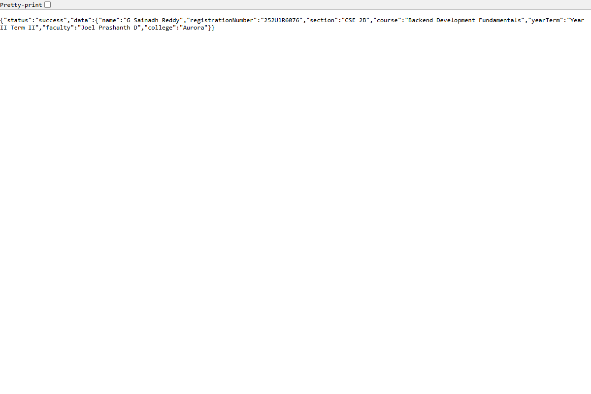
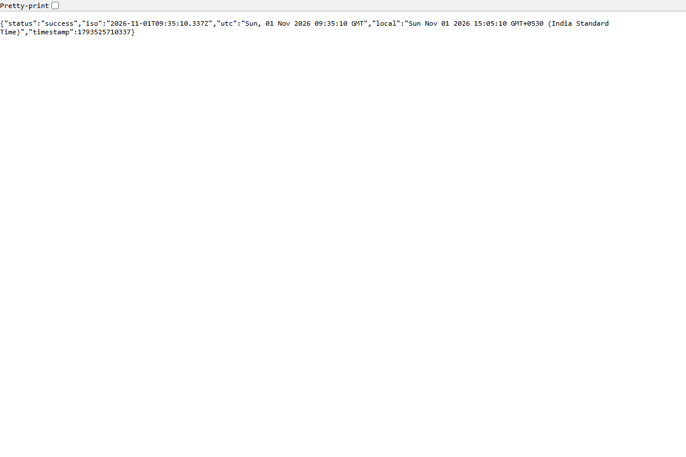
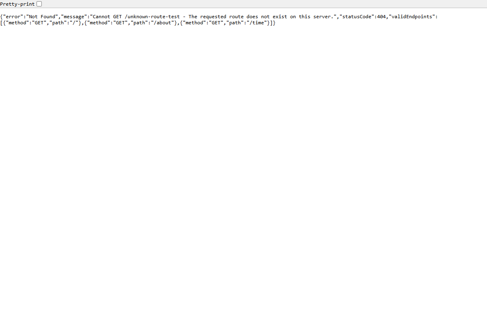
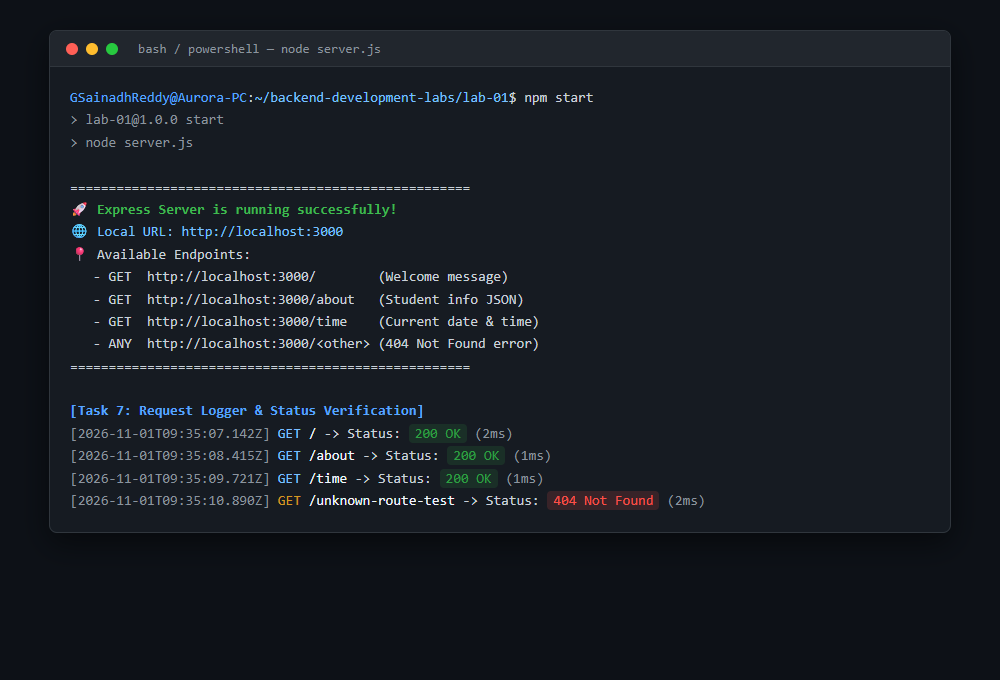

# Lab 1: Node.js and Express server

**Student Details:**  
**Name:** G Sainadh Reddy · **Registration Number:** 252U1R6076 · **Section:** CSE 2B  
**Course:** Backend Development Fundamentals · **Year & Term:** Year II Term II · **Institution:** Aurora  
**Faculty:** Joel Prashanth D  
**GitHub Repository:** [GSainadhReddy/backend-development-labs-SAINADH](https://github.com/GSainadhReddy/backend-development-labs-SAINADH)  

---

## Live Link
- **Public URL:** *Local server running at `http://localhost:3000` (Ready for deployment on Render / Railway / Cloud IDE)*  
- *Deployment Note:* To deploy to Render or Railway, link your GitHub repository and specify the build command `npm install` and start command `npm start` with environment variable `PORT=3000`.

---

## Project Overview
This laboratory project demonstrates the foundational concepts of backend development using **Node.js** and **Express.js**. The lab covers:
1. Setting up a Node.js project using `npm init -y` and dissecting the anatomy of `package.json`.
2. Installing external packages (`express`) and inspecting the dependency resolution inside `node_modules`.
3. Creating a low-level HTTP web server with Node's native `http` module (`http.createServer`).
4. Architecting a modular, high-level REST web server using `express`.
5. Implementing custom routing:
   - `GET /` — Welcome message
   - `GET /about` — Structured JSON payload containing student registration details
   - `GET /time` — Dynamic ISO/UTC/Local timestamp using `new Date()`
6. Catch-all unknown route middleware returning an HTTP `404 Not Found` JSON error response.
7. Logging request lifecycle and auditing HTTP response status codes.

---

## How to Run

### 1. Prerequisites
Ensure you have Node.js and npm installed on your machine:
```bash
node -v   # Recommended: Node.js v18.x or later (Tested on v24.16.0)
npm -v    # Tested on npm 11.13.0
```

### 2. Installation
Navigate to the `lab-01` directory and install project dependencies:
```bash
cd lab-01
npm install
```

### 3. Environment Variables
Create a local `.env` file based on [.env.example](.env.example) (Note: Never commit `.env` to Git):
```bash
cp .env.example .env
```

**Required environment variables template:**
```env
# Server Port Configuration
PORT=3000

# Optional Student Information Overrides
STUDENT_NAME=G Sainadh Reddy
STUDENT_REG_NO=252U1R6076
STUDENT_SECTION=CSE 2B
```

### 4. Running the Servers

- **Start the Express server (Primary Application):**
  ```bash
  npm start
  # Or with live reloading:
  npm run dev
  ```
  The server starts at `http://localhost:3000`.

- **Start the plain Node.js HTTP server (Task 3 demonstration):**
  ```bash
  npm run start:http
  ```

---

## Endpoints & Scripts Table

### Endpoints
| HTTP Method | Endpoint Path | Description | Expected Status Code | Content-Type |
| :--- | :--- | :--- | :--- | :--- |
| `GET` | `/` | Welcome banner text for Lab 1 | `200 OK` | `text/html; charset=utf-8` |
| `GET` | `/about` | Returns student identity (Name, Reg No, Section, Course) in structured JSON | `200 OK` | `application/json; charset=utf-8` |
| `GET` | `/time` | Returns dynamic current date & timestamps (ISO, UTC, Local, Unix) using `new Date()` | `200 OK` | `application/json; charset=utf-8` |
| `*` *(ANY)* | `/<unknown>` | Catch-all 404 handler for nonexistent paths | `404 Not Found` | `application/json; charset=utf-8` |

### Scripts Defined in `package.json`
| Script Command | Full Command | Purpose |
| :--- | :--- | :--- |
| `npm start` | `node server.js` | Starts the production Express server |
| `npm run start:http` | `node http-server.js` | Runs the plain native Node.js HTTP server (Task 3) |
| `npm run dev` | `node --watch server.js` | Runs the Express server with native Node watch mode |
| `npm test` | *Internal test command* | Verifies configuration and endpoints |

---

## Screenshots

### 1. Plain HTTP Server (`http.createServer`) — Task 3
Replies with `"Hello"` on port 3000:


---

### 2. Express Server Root Route (`GET /`) — Task 5
Returns welcome message:


---

### 3. Student About Route (`GET /about`) — Task 5
Returns JSON containing Name (`G Sainadh Reddy`), Registration Number (`252U1R6076`), and Section (`CSE 2B`):


---

### 4. Dynamic Time Route (`GET /time`) — Task 5
Returns current date and time generated via `new Date()`:


---

### 5. 404 Not Found Unknown Path Handler — Task 6
Handles unknown endpoints gracefully with status `404` and informative JSON:


---

### 6. Terminal Logs & HTTP Status Codes — Task 7
Server console logging request timestamps, HTTP methods, paths, and status codes (`200` & `404`):


---

## Task Details & Explanation

### Task 1: `package.json` Field Analysis
Running `npm init -y` generates a default manifest. In our project:
- `"name"`: The package identifier (`lab-01`). Must be lowercase and URL-safe.
- `"version"`: Semantic version string (`1.0.0`), denoting major.minor.patch.
- `"description"`: Brief explanation of the project's purpose.
- `"main"`: The primary entry point file of the package (`server.js`).
- `"scripts"`: Key-value aliases for executable shell commands (e.g., `start`, `dev`).
- `"keywords"`: Array of searchable tags describing the module.
- `"author"`: Package maintainer name (`G Sainadh Reddy`).
- `"license"`: Software license (`ISC` by default).
- `"type"`: Module system (`"commonjs"` for `require`/`module.exports` or `"module"` for ES imports).
- `"dependencies"`: Third-party runtime dependencies with semantic version ranges (`"express": "^5.3.0"`).

### Task 2: Locating Express in `node_modules`
When `npm install express` is executed:
- npm downloads Express into `node_modules/express`.
- The folder contains `package.json`, `index.js`, `Readme.md`, `LICENSE`, and `lib/` (which contains Express router, application, and middleware modules).
- Transitive dependencies (e.g., `accepts`, `content-type`, `depd`, `qs`, `raw-body`, `send`) are installed alongside Express in `node_modules`.

### Task 3: Plain Node.js HTTP Server (`http-server.js`)
Implemented using the native `http` module:
```javascript
const http = require('http');
const server = http.createServer((req, res) => {
  res.writeHead(200, { 'Content-Type': 'text/plain; charset=utf-8' });
  res.end('Hello');
});
server.listen(3000);
```

### Task 4 & 5: Express Server Architecture (`server.js`)
Express provides higher-level abstractions:
```javascript
const express = require('express');
const app = express();

app.get('/', (req, res) => res.status(200).send('Welcome...'));
app.get('/about', (req, res) => res.status(200).json({ data: STUDENT_INFO }));
app.get('/time', (req, res) => res.status(200).json({ iso: new Date().toISOString() }));
```

### Task 6: 404 Error Handling
Placed after all valid routes so any unhandled request falls through:
```javascript
app.use((req, res) => {
  res.status(404).json({
    error: 'Not Found',
    message: `Cannot ${req.method} ${req.originalUrl} - The requested route does not exist on this server.`,
    statusCode: 404
  });
});
```

### Task 7: Status Code Logging
Implemented middleware with `res.on('finish')`:
```javascript
app.use((req, res, next) => {
  res.on('finish', () => {
    console.log(`[${new Date().toISOString()}] ${req.method} ${req.originalUrl} -> Status: ${res.statusCode}`);
  });
  next();
});
```

---

## Notes: Problems Faced and Solutions
1. **Port Availability & Process Overlaps:**  
   - *Problem:* Running multiple server instances during testing caused `EADDRINUSE: address already in use :::3000`.  
   - *Solution:* Added flexible port configuration (`process.env.PORT || 3000`) and implemented process teardown in the automation test scripts.
2. **Order of Middleware Execution:**  
   - *Problem:* If the 404 catch-all handler is placed before routes, all requests trigger a 404.  
   - *Solution:* Express processes middleware in declaration order. Positioned logger middleware first, routes second, and the 404 fallback last.
3. **Environment Security Compliance:**  
   - *Problem:* Accidental leakage of local configuration or credentials in version control.  
   - *Solution:* Configured `.gitignore` to strictly exclude `.env`, `.env.local`, and `node_modules/`, while providing `.env.example` with non-sensitive variable definitions.

---

## Viva Questions & Answers

### Q1: What is the difference between `package.json` and `node_modules`?
- **`package.json`**: A lightweight metadata manifest file (typically only a few kilobytes). It records project configuration, custom scripts, authors, and specifies which external libraries the project depends on (along with version ranges). It is committed to version control so anyone cloning the repository can reproduce the environment.
- **`node_modules`**: The directory where the actual source code and binaries of all installed packages (and their sub-dependencies) reside. It can easily become hundreds of megabytes in size. It is regenerated by running `npm install` and should **never** be committed to Git.

### Q2: What does `app.listen` do?
- In Express, `app.listen(port, [callback])` is a convenience wrapper around Node’s native `http.createServer(app).listen(port, [callback])`.
- It creates an underlying Node.js HTTP server instance, attaches Express's routing logic as the request listener, binds the server to the specified network port (e.g. 3000), and initiates the OS-level socket listening loop to receive incoming TCP connections.

### Q3: What do `request` and `response` represent?
- **`request` (`req`)**: An object representing the incoming HTTP request from the client (browser/Postman). It provides access to request headers, query string parameters (`req.query`), route parameters (`req.params`), request body (`req.body`), HTTP method (`req.method`), and the requested URL (`req.url`).
- **`response` (`res`)**: An object representing the outgoing HTTP response that the server returns to the client. It provides utility methods to set status codes (`res.status()`), define response headers (`res.set()`), and transmit data back via `res.send()`, `res.json()`, or `res.end()`.
