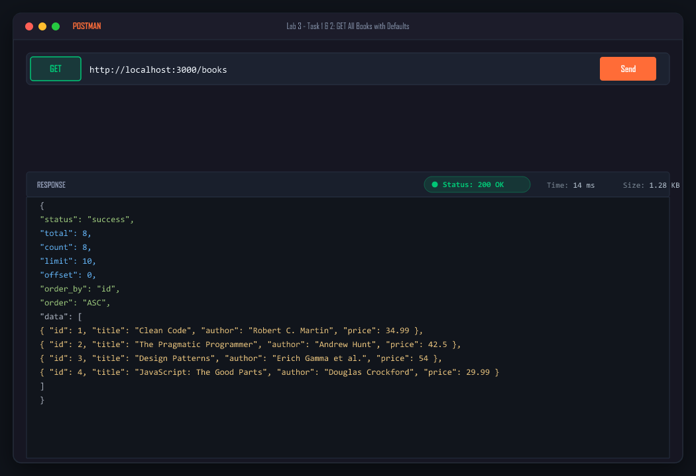
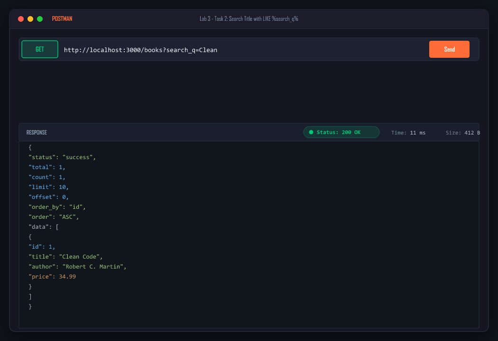
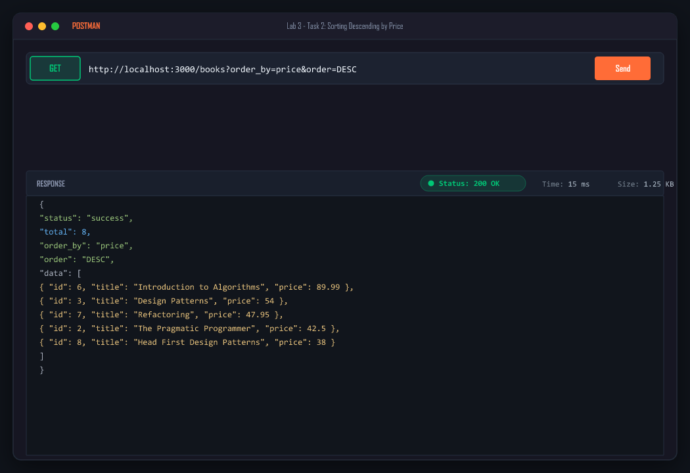
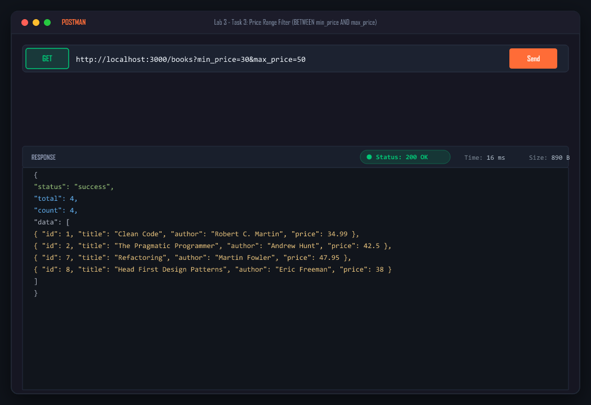
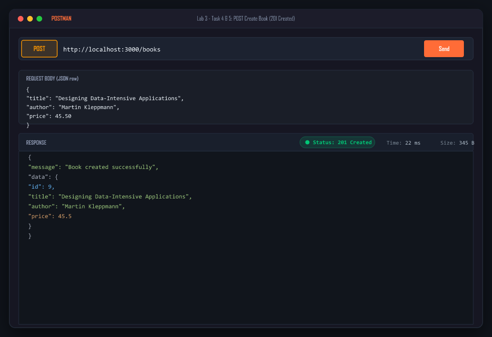
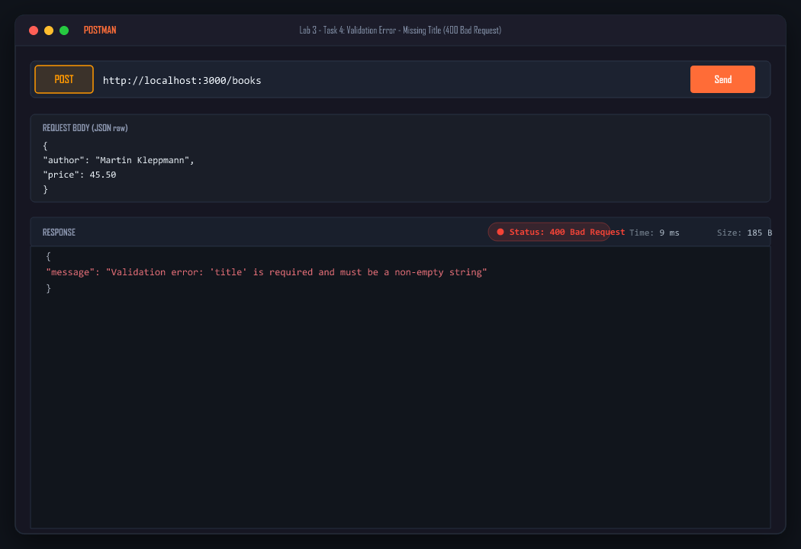
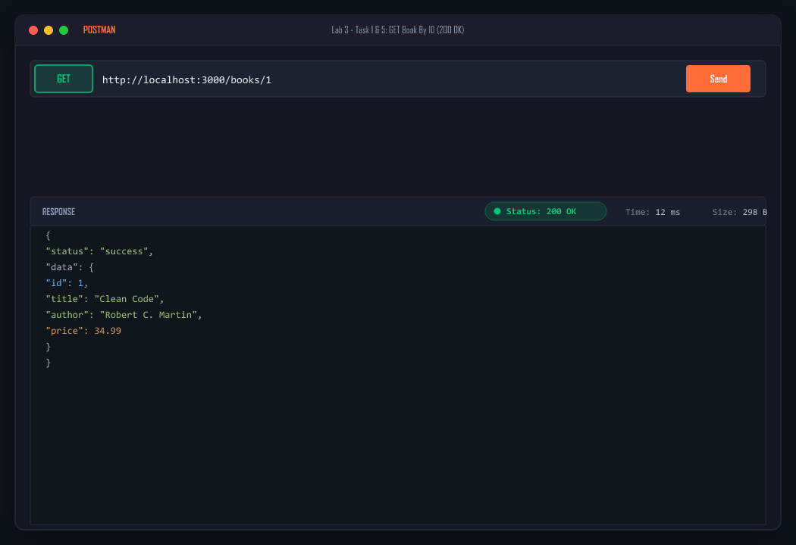
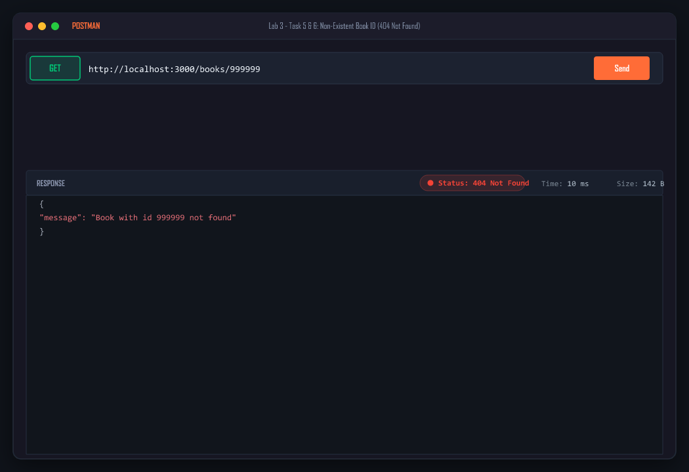

# Lab 3: REST API, query parameters, validation, debugging

**Student Details:**  
**Name:** G Sainadh Reddy · **Registration Number:** 252U1R6076 · **Section:** CSE 2B  
**Course:** Backend Development Fundamentals · **Year & Term:** Year II Term II · **Institution:** Aurora  
**Faculty:** Joel Prashanth D  
**GitHub Repository:** [GSainadhReddy/backend-development-labs-SAINADH](https://github.com/GSainadhReddy/backend-development-labs-SAINADH)  
**Lab Folder:** `lab-03/`  
**Live Vercel Deployment:** [https://lab-02-coral.vercel.app/lab-03/books](https://lab-02-coral.vercel.app/lab-03/books)  

---

## 🌐 Live Vercel Endpoints
- **Overview & Metadata:** [https://lab-02-coral.vercel.app/lab-03](https://lab-02-coral.vercel.app/lab-03)
- **GET All Books (Default):** [https://lab-02-coral.vercel.app/lab-03/books](https://lab-02-coral.vercel.app/lab-03/books)
- **Search by Title (`search_q=Clean`):** [https://lab-02-coral.vercel.app/lab-03/books?search_q=Clean](https://lab-02-coral.vercel.app/lab-03/books?search_q=Clean)
- **Sort Descending by Price:** [https://lab-02-coral.vercel.app/lab-03/books?order_by=price&order=DESC](https://lab-02-coral.vercel.app/lab-03/books?order_by=price&order=DESC)
- **Price Range Filter (30 to 50):** [https://lab-02-coral.vercel.app/lab-03/books?min_price=30&max_price=50](https://lab-02-coral.vercel.app/lab-03/books?min_price=30&max_price=50)
- **GET Single Book (ID 1):** [https://lab-02-coral.vercel.app/lab-03/books/1](https://lab-02-coral.vercel.app/lab-03/books/1)
- **404 Not Found Test:** [https://lab-02-coral.vercel.app/lab-03/books/999999](https://lab-02-coral.vercel.app/lab-03/books/999999)

---

## 📋 Table of Contents
- [Objective](#objective)
- [Folder Structure](#folder-structure)
- [Setup & Installation](#setup--installation)
- [REST API Specifications](#rest-api-specifications)
- [Query Parameters & Filtering](#query-parameters--filtering)
- [Validation Rules & Error Handling](#validation-rules--error-handling)
- [Postman Test Suite](#postman-test-suite)
- [Debugging Exercise Walkthrough](#debugging-exercise-walkthrough)
- [Viva Questions & Answers](#viva-questions--answers)
- [Submission Guidelines](#submission-guidelines)

---

## 🎯 Objective
Transform raw backend routes into a production-grade RESTful API featuring:
1. Standardized noun-based REST endpoints (`/books`) with appropriate HTTP verbs.
2. Robust query parameter handling: search (`search_q`), sorting (`order_by`, `order`), pagination (`limit`, `offset`), and numeric range filtering (`min_price`, `max_price`).
3. Strict input validation with meaningful error messages and correct status codes (`400`, `404`, `201`, `200`).
4. Consistent JSON response schemas.
5. Practical debugging skills to identify and fix common backend pitfalls: port conflicts (`EADDRINUSE`), broken module paths, SQL table typos, and missing `await` statements.

---

## 📂 Folder Structure

```text
backend-course/
└── lab-03/
    ├── database.js                    # SQLite database connection, table initialization & seeding
    ├── server.js                      # Express application, REST endpoints, validation & error handling
    ├── test-api.js                    # Automated end-to-end integration test suite
    ├── package.json                   # Project dependencies and npm scripts
    ├── books.db                       # SQLite database file (auto-generated)
    ├── README.md                      # Complete documentation & viva prep
    ├── postman/
    │   ├── Lab_03_REST_API.postman_collection.json  # Importable Postman v2.1 collection
    │   └── POSTMAN_TESTS.md                         # Detailed test catalog with cURL snippets
    └── debugging-exercise/
        ├── broken-server.js           # Handout version containing the 4 faculty bugs
        ├── fixed-server.js            # Fully resolved & annotated solution file
        └── DEBUGGING_GUIDE.md         # In-depth technical breakdown of each bug and fix
```

---

## ⚙️ Setup & Installation

### 1. Prerequisites
- Node.js (v18.x or newer)
- npm (v9.x or newer)

### 2. Install Dependencies
Navigate into the `lab-03/` directory and install the required packages:
```bash
cd lab-03
npm install
```

### 3. Run the Server
```bash
npm start
```
The server will start on port `3000` (or `process.env.PORT` if provided):
```text
===============================================
  Lab 3 REST API Server running on port 3000
  URL: http://localhost:3000/books
===============================================
```

### 4. Run Automated Test Suite
To execute the automated test script covering all success, query, and validation failure scenarios:
```bash
npm test
```

---

## 🛣️ REST API Specifications

| Method | Endpoint | Description | Request Body | Success Status | Failure Status |
|:---:|---|---|:---:|:---:|:---:|
| `GET` | `/books` | Retrieve list of books with search, sort & pagination | None | `200 OK` | `400 Bad Request` |
| `GET` | `/books/:id` | Retrieve single book details by ID | None | `200 OK` | `404 Not Found` / `400 Bad Request` |
| `POST` | `/books` | Create a new book record | JSON object (`title`, `author`, `price`) | `201 Created` | `400 Bad Request` |
| `PUT` | `/books/:id` | Update existing book by ID | JSON object (`title`, `author`, `price`) | `200 OK` | `404 Not Found` / `400 Bad Request` |
| `DELETE` | `/books/:id` | Delete book record by ID | None | `200 OK` | `404 Not Found` / `400 Bad Request` |

---

## 🔍 Query Parameters & Filtering (`GET /books`)

All query parameters come with safe defaults and SQL injection protection:

| Parameter | Type | Default | Description | Example |
|---|:---:|:---:|---|---|
| `search_q` | String | `""` | Case-insensitive partial title match (`title LIKE %search_q%`) | `?search_q=Clean` |
| `order_by` | String | `"id"` | Column to sort by (`id`, `title`, `author`, `price`) | `?order_by=price` |
| `order` | String | `"ASC"` | Sort direction (`ASC` or `DESC`) | `?order=DESC` |
| `limit` | Integer | `10` | Maximum number of records to return | `?limit=5` |
| `offset` | Integer | `0` | Number of records to skip (pagination offset) | `?offset=10` |
| `min_price` | Number | `undefined` | Filter books with price greater than or equal to value | `?min_price=25.00` |
| `max_price` | Number | `undefined` | Filter books with price less than or equal to value | `?max_price=60.00` |

### Combined Query Example:
```text
GET /books?search_q=Programmer&min_price=20&max_price=50&order_by=price&order=ASC&limit=5&offset=0
```

---

## 🛡️ Validation Rules & Error Handling

### 1. POST /books Body Validation
The middleware `validateBookBody` enforces:
1. `title`: Must exist, be a `string`, and not be empty after trimming.
2. `author`: Must exist, be a `string`, and not be empty after trimming.
3. `price`: Must exist, cannot be boolean or object, must parse to a valid number, and must be $\ge 0$.

If validation fails, the API responds with **HTTP 400 Bad Request**:
```json
{
  "message": "Validation error: 'price' is required and must be a non-negative number"
}
```

### 2. Consistent Error Responses
All errors follow a unified JSON schema:
```json
{
  "message": "<Clear explanation of the error>"
}
```

---

## 🧪 Postman Test Suite

A complete test suite is available in [`postman/Lab_03_REST_API.postman_collection.json`](./postman/Lab_03_REST_API.postman_collection.json).

### How to Import & Run in Postman:
1. Open **Postman**.
2. Click **Import** (top left).
3. Drag and drop `Lab_03_REST_API.postman_collection.json`.
4. Ensure your server is running on `http://localhost:3000`.
5. Click on the collection name and select **Run collection** to run all test assertions.

Detailed cURL commands and response samples are documented in [`postman/POSTMAN_TESTS.md`](./postman/POSTMAN_TESTS.md).

---

## 📸 Postman Execution Screenshots

### 1. GET /books — Default List & Pagination (200 OK)


### 2. GET /books?search_q=Clean — Partial Title Search with LIKE (200 OK)


### 3. GET /books?order_by=price&order=DESC — Sorting Descending by Price (200 OK)


### 4. GET /books?min_price=30&max_price=50 — Price Range Filter (200 OK)


### 5. POST /books — Create Book (201 Created)


### 6. POST /books — Validation Error: Missing Title (400 Bad Request)


### 7. GET /books/1 — Retrieve Single Book Details (200 OK)


### 8. GET /books/999999 — Non-existent Record (404 Not Found)


---

## 🛠️ Debugging Exercise Walkthrough

The faculty handout contains 4 intentional bugs in `debugging-exercise/broken-server.js`:

| Bug # | Type | Error / Behavior | Cause | Fix |
|:---:|---|---|---|---|
| **1** | Wrong Import Path | `MODULE_NOT_FOUND: Cannot find module './db/database'` | File is located at `../database.js`, not `./db/database` | `require('../database')` |
| **2** | Port Conflict | `Error: listen EADDRINUSE: address already in use :::3000` | Port 3000 is occupied and hardcoded without fallback | `process.env.PORT \|\| 3000` & error listener |
| **3** | Table Typo | `SQLITE_ERROR: no such table: book` | Queried `book` (singular) instead of `books` | Change SQL query to `FROM books` |
| **4** | Missing `await` | `GET /books/1` returns `{}` and skips 404 check | `db.get()` returns a Promise; missing `await` passes truthy Promise | `const book = await db.get(...)` |

👉 Read the full debugging guide in [`debugging-exercise/DEBUGGING_GUIDE.md`](./debugging-exercise/DEBUGGING_GUIDE.md).

---

## 🎓 Viva Questions & Answers

### Q1: What is the difference between a Query Parameter and a Path Parameter?
**Answer:**
- **Path Parameter (Route Parameter):**
  - **Purpose:** Identifies a **specific resource** hierarchically in the URL path.
  - **Syntax:** `/books/:id` (e.g., `/books/42`).
  - **When to use:** When the parameter is essential to locate a single entity or resource instance.
- **Query Parameter:**
  - **Purpose:** Used to **filter, sort, search, or paginate** a collection without changing the resource itself.
  - **Syntax:** Appended after a `?` in key-value pairs (e.g., `/books?search_q=Clean&limit=5`).
  - **When to use:** For optional parameters that modify how the resource collection is viewed.

---

### Q2: What does "Stateless" mean in RESTful API architecture?
**Answer:**
- In a REST API, **statelessness** means that **no client session state or context is stored on the server between requests**.
- Every single HTTP request from a client must contain **all the necessary information** (e.g., authentication tokens, headers, query parameters, body) for the server to understand and process that request independently.
- **Benefits:**
  - **Scalability:** Any server instance behind a load balancer can handle any request.
  - **Reliability:** Server crashes do not corrupt client sessions.
  - **Simplicity:** The server does not have to maintain complex session synchronization mechanisms.

---

### Q3: Which HTTP status code should be returned for bad input vs. a missing record?
**Answer:**
- **Bad Input $\rightarrow$ `400 Bad Request`:**
  - Returned when the client sends malformed JSON, missing mandatory fields (e.g. missing `title` or `author`), invalid data types (e.g. non-numeric `price`), or out-of-range query parameters (e.g. `min_price > max_price`).
- **Missing Record $\rightarrow$ `404 Not Found`:**
  - Returned when the request is syntactically valid and the endpoint exists, but the specific resource identifier does not match any existing record in the database (e.g. `GET /books/999999`).

---

## 🚀 GitHub Repository Submission Guide

To submit this lab as part of your overall course repository:

1. **Initialize Git (if not already done):**
   ```bash
   cd backend-course
   git init
   ```
2. **Add and Commit Lab 3:**
   ```bash
   git add lab-03/
   git commit -m "Complete Lab 3: REST API, query parameters, validation, and debugging"
   ```
3. **Link to your Public GitHub Repository:**
   ```bash
   git branch -M main
   git remote add origin https://github.com/<your-username>/<your-repo-name>.git
   git push -u origin main
   ```
4. **Submit Link:**
   Provide your public GitHub repository URL to Faculty Joel Prashanth D.

